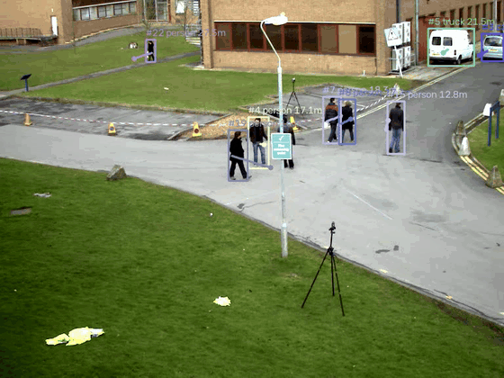
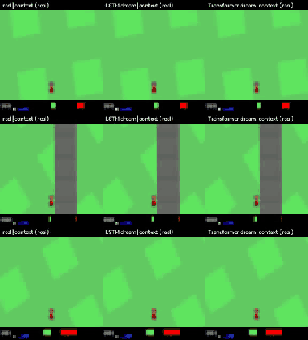
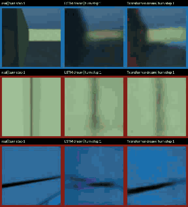
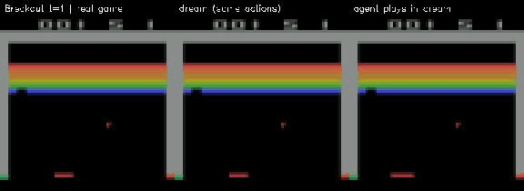
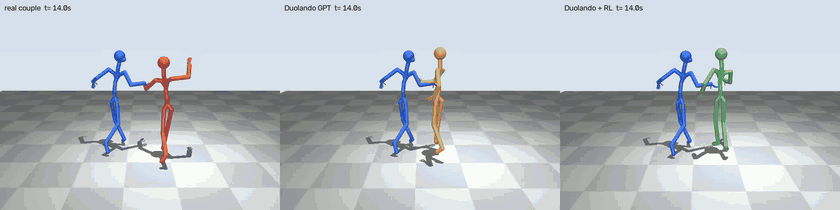
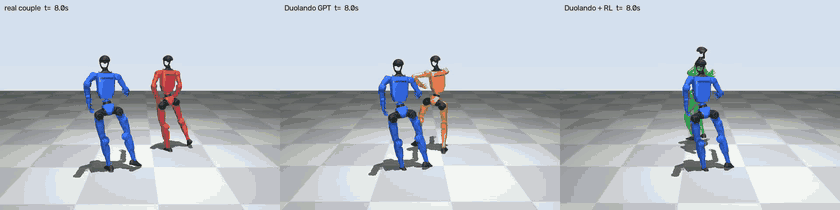
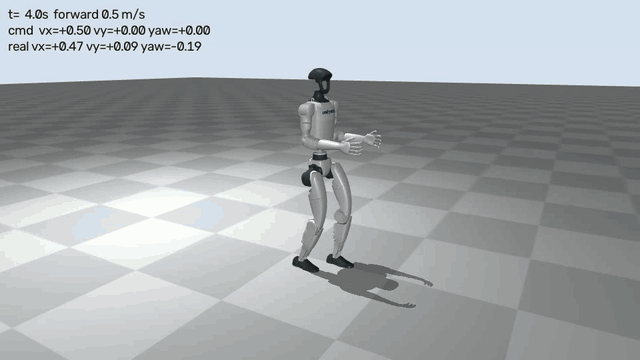

# world-model

世界模型實驗：從「看懂 3D」到「預測世界怎麼變」。目標硬體是 iMac M3（PyTorch `mps`）。

## 安裝

```bash
uv sync          # Python 3.12（.python-version）；Memory Maze 在 macOS 需 MUJOCO_GL=glfw
```

## 實驗

先讀 **[doc/overview.md](doc/overview.md)**：背景、各實驗的重點結果與總結論。
世界模型和強化學習的關係見 [doc/rl_vs_world_model.md](doc/rl_vs_world_model.md)。


| 實驗 | 內容 | 要訓練？ | 文件 |
|---|---|---|---|
| A | YOLO11n 追蹤 + Depth Anything V2 metric → 3D 軌跡 → Kalman 預測未來 | 否 | [doc/exp_a.md](doc/exp_a.md) |
| B1 | KITTI Tracking 3D 真值軌跡 → 小 GRU vs. 等速基準，含模擬單眼噪音 | 是（20 秒） | [doc/exp_b.md](doc/exp_b.md) |
| C | World Models (CarRacing)：VAE 潛在空間 + MDN-LSTM vs. MDN-Transformer 做夢 | 是（約 35 分鐘） | [doc/exp_c.md](doc/exp_c.md) |
| D | Memory Maze 第一人稱 3D 迷宮：探針與「夢裡轉圈」考 3D 世界模型 | 是（約 35 分鐘） | [doc/exp_d.md](doc/exp_d.md) |
| E | 跑現成的 diffusion 世界模型 DIAMOND（Atari 預訓練權重）：夢 vs 真實 | 否（約 12 分鐘） | [doc/exp_e.md](doc/exp_e.md) |
| F | 雙人舞跟舞：給真實男方與音樂，Duolando 生成女方（DD100 Jive），MuJoCo 雙木偶人播放 | 否（約 15 分鐘，下載 7 GB） | [doc/exp_f.md](doc/exp_f.md) |
| G | Unitree 官方預訓練的 G1 行走策略：MuJoCo 物理中走路、轉彎、抗推 | 否（約 2 分鐘） | [doc/exp_g.md](doc/exp_g.md) |

## 結構

```
wm/        共用模組（相機幾何、深度模型、Kalman）
exp_a/     實驗 A：track3d.py（感知）、forecast.py（動態）
exp_b/     實驗 B1：kitti.py（讀取＋座標轉換）、train.py（GRU 與基準）
exp_c/     實驗 C：collect.py → train_vae.py → train_m.py → dream.py
exp_d/     實驗 D：collect.py（Memory Maze）、evaluate.py（探針＋轉圈）；V/M 沿用 exp_c
exp_e/     實驗 E：diamond_dream.py（用 external/diamond 的獨立環境執行）
exp_f/     實驗 F：duolando_follow.py（用 external/duolando 的環境）、render_duet.py、puppet.py（MuJoCo 木偶人）、g1_retarget.py（套到 G1）
exp_g/     實驗 G：g1_walk.py（官方 G1 行走策略，物理模擬）
external/  第三方程式碼（DIAMOND、Duolando、mujoco_menagerie、unitree_rl_gym），不進 git
doc/       實驗說明與結果
data/ out/ models/   資料、輸出、權重（不進 git）
```

## 成果一覽

| 實驗 A：單眼 3D 追蹤與預測 | 實驗 C：World Models 做夢 |
|---|---|
|  |  |

| 實驗 D：3D 迷宮裡夢中轉圈（左：真實，中：LSTM，右：Transformer） |
|---|
|  |

| 實驗 E：DIAMOND 預訓練世界模型（左：真實，中：夢，右：agent 在夢裡玩） |
|---|
|  |

| 實驗 F：雙人 Jive 跟舞（左：真實，中：Duolando GPT，右：+RL；藍色男方皆為真實資料） |
|---|
|  |

| 實驗 F 延伸：同樣的 Jive 套到兩台 Unitree G1 |
|---|
|  |

| 實驗 G：G1 在物理模擬中走路（官方預訓練策略） |
|---|
|  |
