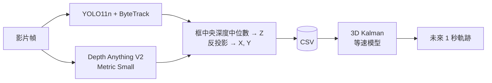

# 實驗 A：單眼 3D 追蹤 + 等速 Kalman 預測

最簡單的「物件中心世界模型」：狀態是人手定義的 3D 位置與速度，轉移函數是物理（等速運動）。



## 執行

```bash
uv run python exp_a/track3d.py data/vtest.avi --hfov 60 --yolo models/yolo11n.pt --out out/vtest.csv
```

```bash
uv run python exp_a/forecast.py out/vtest.csv --horizon 1.0
```

- 測試影片：OpenCV 範例 `vtest.avi`（768×576，10 fps，795 幀，行人）。下載：

```bash
curl -L -o data/vtest.avi https://raw.githubusercontent.com/opencv/opencv/4.x/samples/data/vtest.avi
```

- 自己拍的 iPhone 影片：主鏡頭水平視角約 69°（`--hfov 69`，預設值）。影片很長可以用 `--stride 3`。
- 輸出：`out/vtest_bev.png`（鳥瞰圖）、`out/vtest_forecast.mp4`（畫面上投影出未來軌跡）、`out/vtest_metrics.json`。

## 方法

1. **3D 位置**：框中央 50% 區域深度中位數當 $Z$，框中心 $(u,v)$ 反投影
   $X=(u-c_x)Z/f_x,\ Y=(v-c_y)Z/f_y$。沒有標定時用水平視角估計 $f_x = \frac{W/2}{\tan(\text{hfov}/2)}$。
2. **動態模型**：狀態 $s=(X,Y,Z,\dot X,\dot Y,\dot Z)$，
   $s_{t+1}=F s_t + w$，$w$ 為白噪音加速度（`--sigma-a`）。
   觀測噪音 $R$ 隨距離放大：$\sigma_{xy}=0.02Z$、$\sigma_z=0.10Z$。
3. **預測**：不再加入觀測，讓狀態往前滾 $n$ 步，這就是「想像未來」。
4. **評估**：鳥瞰平面 (X-Z) 的 ADE（平均位移誤差）/ FDE（最終位移誤差），和兩個基準比：
   - `static`：物體原地不動
   - `cv_raw`：用最後兩個原始觀測算速度，直接外插

## 結果（vtest.avi，M3 8GB）

感知約 1.8–3 fps（795 幀約 7 分鐘），預測不到 1 秒。

| horizon | static ADE/FDE | cv_raw ADE/FDE | kalman ADE/FDE |
|---|---|---|---|
| 0.5 s | **0.79 / 1.01** | 1.86 / 2.91 | 0.93 / 1.08 |
| 1.0 s | **1.00 / 1.38** | 3.10 / 5.39 | 1.09 / 1.42 |
| 2.0 s | **1.33 / 1.99** | 5.53 / 10.29 | 1.42 / 2.15 |

`sigma_a` 掃描（1 s）：0.1 → 1.58、0.3 → 1.26、1.0 → 1.09、3.0 → 1.07，都沒贏過 `static`。

## 觀察

1. **單眼深度的噪音是主角**。鳥瞰圖右上兩條綠/橘長條是停著的車，卻沿著視線方向被拉成 3–5 m 長，
   這就是 $Z$ 的抖動。誤差方向沿著視線，大小和距離成正比。
2. **`cv_raw` 慘敗**：兩個噪音觀測相減再除以 0.1 s，速度噪音被放大 10 倍。這是「為什麼需要狀態估計」最好的例子。
3. **Kalman 比 `cv_raw` 好很多，但還輸 `static` 一點**，原因：
   - 評估的「答案」本身就是有噪音的原始觀測，誤差有一個無法降低的底線（約等於觀測噪音）。
   - 畫面中有不少不動的東西（停著的車、站著的人），對它們而言「不動」就是完美預測。
   - 行人走路速度約 1.4 m/s，1 秒只走 1.4 m，和深度噪音同一個數量級，訊號雜訊比很低。
4. 所以「手寫物理」的世界模型在這裡已經碰到極限：瓶頸在**感知**（深度噪音），不在**動態**。

## 可以接著做

- 用有 3D 真值的資料（KITTI Tracking、nuScenes-mini）評估，答案不再有噪音 → 實驗 B。
- 用框的底邊（腳的位置）加上地面平面假設求 $Z$，取代深度中位數，通常更穩。
- 學習式動態模型（GRU/Transformer）：能學到「人會轉彎、會停」，以及怎麼面對深度噪音。
