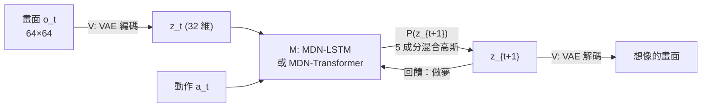
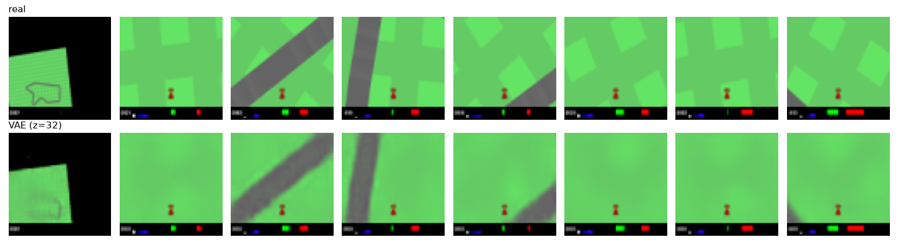
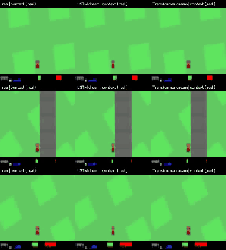
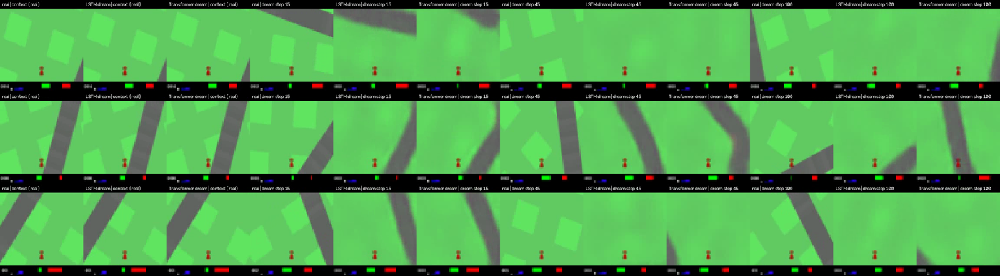
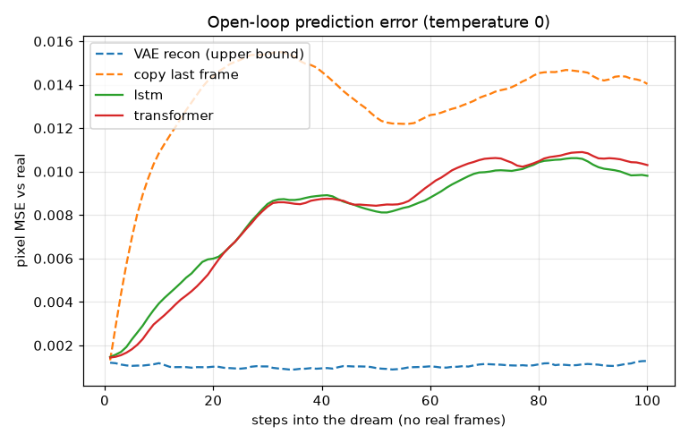

# 實驗 C：World Models（CarRacing）— LSTM vs. Transformer

重現 Ha & Schmidhuber (2018) [World Models](https://worldmodels.github.io/) 的 V 與 M，
並把 M 的骨幹換成 Transformer 做對照。實驗 A、B 的狀態是人手定義的 3D 座標；
這裡的狀態 $z$ 是**從畫面學出來的** 32 維向量。



## 執行

```bash
uv run python exp_c/collect.py --n 300 --steps 400 --workers 4
```

```bash
uv run python exp_c/train_vae.py --epochs 10
```

```bash
uv run python exp_c/train_m.py --kind lstm
```

```bash
uv run python exp_c/train_m.py --kind transformer
```

```bash
uv run python exp_c/dream.py
```

## 時間（iMac M3 8GB，mps）

| 步驟 | 規模 | 時間 |
|---|---|---|
| 收集 | 300 回合 × 400 步 = 12 萬幀（116 MB） | 4.5 分鐘 |
| VAE | 10 epoch，batch 128 | **26 分鐘**（主要瓶頸） |
| MDN-LSTM | 4000 步，batch 64 × 32 幀 | 46 秒 |
| MDN-Transformer | 同上 | 116 秒 |
| 做夢與評估 | 90 段 × 100 步 | < 1 分鐘 |

## 設定

- **收集**：隨機策略，方向盤用 OU 過程（平滑隨機），油門偏向前進，5% 機率踩煞車。
- **V**：原論文的卷積 VAE，$z \in \mathbb{R}^{32}$，KL 免費額度每維 0.5。
- **M**：輸入 $[z_t, a_t]$，輸出每一維 $z_{t+1}$ 的 5 成分混合高斯，loss 為負對數似然 (NLL)。

| | MDN-LSTM | MDN-Transformer |
|---|---|---|
| 結構 | 1 層 LSTM，hidden 256 | 4 層，d=128，4 heads，因果遮罩 |
| 參數 | 423K | 864K |
| 記憶 | 隱藏狀態 $h_t$（理論上無限長） | context 視窗 32 幀 |

- **做夢評估**：測試回合（最後 10%）給 16 幀真實畫面當開頭，之後只給真實動作、不給畫面，
  讓 M 自己往前滾 100 步，解碼後和真實畫面比 pixel MSE。

## 結果

| 方法 | 第 1 步 | 第 10 步 | 第 30 步 | 第 100 步 |
|---|---|---|---|---|
| VAE 重建（上限） | 0.0012 | 0.0012 | 0.0010 | 0.0013 |
| 複製最後一幀（下限） | 0.0013 | 0.0109 | 0.0154 | 0.0140 |
| **LSTM** | 0.0015 | 0.0039 | 0.0085 | **0.0098** |
| **Transformer** | 0.0014 | **0.0032** | 0.0084 | 0.0103 |

| | LSTM | Transformer |
|---|---|---|
| 測試 NLL | 0.517 | **0.483** |
| 做夢速度 | **4,148 步/秒** | 563 步/秒 |
| 訓練時間 | **46 秒** | 116 秒 |

### VAE 重建

上排是真實畫面，下排是經過 32 維 $z$ 重建的畫面。道路形狀、車子和儀表板都保留了，草地上的方塊紋理被抹平。



### 夢境影片

三段測試片段。每排從左到右是真實畫面、LSTM 的夢、Transformer 的夢。
前 16 幀（context）三者相同；之後模型看不到真實畫面，只拿到真實的動作序列。



完整畫質（H.264）：[media/exp_c_dream.mp4](media/exp_c_dream.mp4)

靜態截圖，由左到右依序是 context、夢境第 15、45、100 步（每段三格：真實 | LSTM | Transformer）：



第二排可以看到兩個模型都想像出彎道，但彎的方向和時機跟真實不同。
第一排到了第 100 步，真實畫面左側出現了道路，兩個模型卻都還夢成「一片草地」，這是資料偏差造成的（見觀察 7）。

### 開環預測誤差

虛線是兩個參考：VAE 重建是 V 能達到的上限，「複製最後一幀」是什麼都不預測的下限。



## 觀察

1. **兩者都學會了「世界怎麼動」**：給方向盤和油門，想像中的賽道會往正確方向移動、旋轉，甚至會想像出彎道。
   前 10 步的誤差只有「複製最後一幀」的 1/3。
2. **短期 Transformer 略好**（第 10 步 0.0032 vs 0.0039，NLL 也較低），因為它能直接回看最近幾幀算速度。
3. **長期打平，Transformer 甚至略差**：30 步之後兩者都收斂到約 0.010。
   這不是模型不夠好，而是世界本身有不確定性。隨機策略下賽道下一段怎麼彎，從過去畫面無法得知，
   期望值預測會變成「模糊的平均畫面」。這時比的是機率分布，不是單一畫面。
4. **速度差 7 倍**：LSTM 每步 $O(1)$，Transformer 每步要重算整個 context。
   之後訓練控制器要在夢裡跑上百萬步，這個差距很關鍵。這就是原論文和 DreamerV3 用 RNN 的實際理由。
5. **在這個規模，RNN 是較好的選擇**：任務只需要短期記憶，資料量小，Transformer 的長距離注意力用不上。
6. **VAE 是瓶頸**，包括時間（26 分鐘，佔總時間大半）和品質（草地紋理被抹平，只保留道路形狀和車）。
   這正是 V-JEPA 的論點：重建像素浪費容量在不重要的細節上。
7. **資料偏差**：隨機策略常把車開出賽道，所以資料大量是草地。溫度 0 的長期夢境會漂向「一片草地」。

## 可以接著做

- **C 的第 4 步：控制器**。$a_t = W[z_t, h_t] + b$（只有 867 個參數），用 CMA-ES 在真實環境或夢裡優化，預計一晚。
- **迭代收集**：用訓練好的控制器重新收集資料（車會留在賽道上），再重訓 V 和 M。
- **長記憶任務**：設計需要記住 32 幀以前資訊的環境，才看得出 Transformer 的優勢。
- **換掉 VAE**：直接在 M 的預測誤差上學表示（JEPA 風格），不重建像素。
