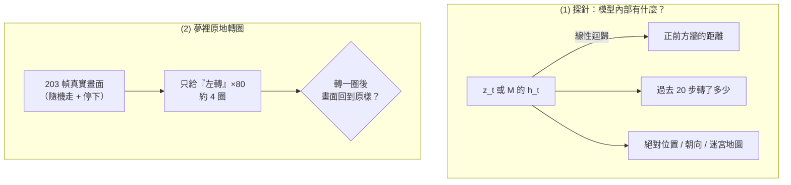
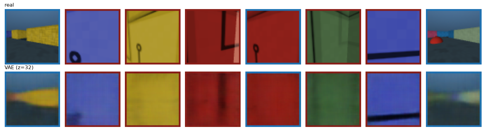
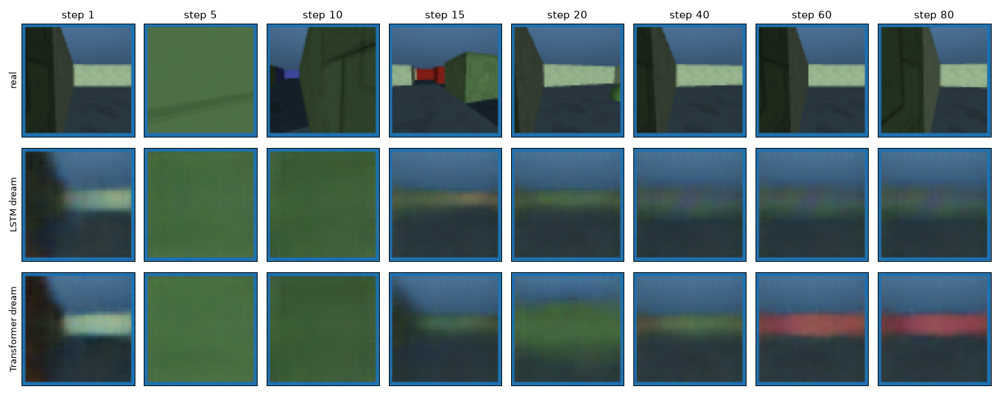
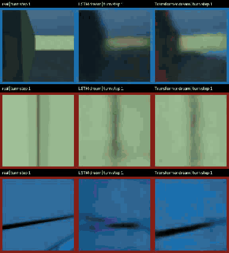
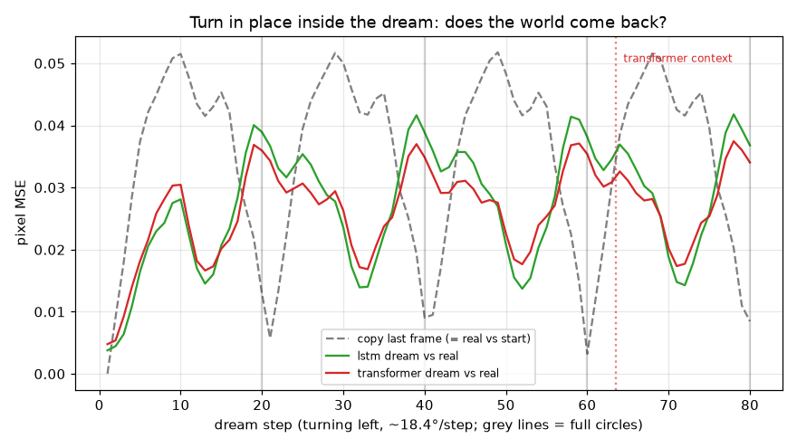

# 實驗 D：考 3D 世界模型（Memory Maze）

實驗 C 的 CarRacing 是俯視視角，畫面本身就是 2D 地圖，考不到 3D。
這裡換成 [Memory Maze](https://github.com/jurgisp/memory-maze)（DeepMind 2022）：**第一人稱、有透視的 3D 迷宮**，
每回合隨機生成 9×9 迷宮，並提供 agent 位置、朝向、迷宮格局等「真值」，可以拿來檢查模型內部到底有沒有 3D。

模型完全沿用實驗 C（VAE + MDN-LSTM / MDN-Transformer），只換環境、動作改為 6 種離散動作（one-hot），
序列長度與 Transformer context 加長到 64。

## 兩種考法



| 探針目標 | 需要什麼能力 | 只看當下畫面做得到嗎？ |
|---|---|---|
| 正前方牆的距離 | **單張畫面的 3D 感知**（透視 → 深度） | 可以 |
| 過去 20 步轉了多少度 | **短期記憶**（路徑積分） | 不行 |
| 絕對位置、朝向、迷宮 9×9 格局 | **長期記憶 + 地圖**（把看過的拼成 3D 地圖） | 不行 |

## 執行

需要 Python 3.12（`labmaze` 沒有 3.13 的 arm64 wheel），專案已用 `.python-version` 固定。
Memory Maze 預設用 EGL 渲染（只有 Linux 有），macOS 要設 `MUJOCO_GL=glfw`。

```bash
MUJOCO_GL=glfw uv run python exp_d/collect.py
```

```bash
uv run python exp_c/train_vae.py --data data/memmaze --prefix exp_d --epochs 10
```

```bash
uv run python exp_c/train_m.py --kind lstm --prefix exp_d --seq 64 --context 64
```

```bash
uv run python exp_c/train_m.py --kind transformer --prefix exp_d --seq 64 --context 64
```

```bash
uv run python exp_d/evaluate.py
```

## 時間（iMac M3 8GB）

| 步驟 | 規模 | 時間 |
|---|---|---|
| 收集 | 100 回合 × 1000 步 + 30 個轉圈回合 = 10.8 萬幀（262 MB） | 12 分鐘 |
| VAE | 9 萬幀，10 epoch | 15.5 分鐘 |
| MDN-LSTM（426K 參數） | 4000 步，batch 64 × 64 幀 | 2 分鐘 |
| MDN-Transformer（868K 參數） | 同上 | 3 分鐘 |
| 評估 | 探針 40 回合 + 轉圈 30 回合 | 約 3 分鐘 |

## 結果

### VAE 重建



牆的顏色、地平線、遠處走廊都保留了；牆上的細節（花紋、彩色目標物）模糊或消失。
畫面外框的顏色是「目前要找的目標物顏色」，屬於環境的提示。

### (1) 探針

線性迴歸（ridge，λ=1000），30 個訓練回合擬合、10 個測試回合評估，只看第 100 步之後。
前四列是 $R^2$（1 = 完美、0 = 等於猜平均、負值 = 比猜平均還差），後兩列是準確率。

| 目標 | 多數猜測 | $z_t$（當下畫面） | LSTM（未訓練） | **LSTM** | **Transformer** |
|---|---|---|---|---|---|
| 正前方牆的距離 | — | 0.549 | 0.601 | **0.741** | 0.691 |
| 過去 20 步轉了多少 | — | 0.094 | 0.196 | **0.266** | 0.264 |
| 絕對位置 (x, y) | — | −0.012 | −0.026 | −0.171 | −0.125 |
| 絕對朝向 | — | −0.013 | −0.069 | −0.191 | −0.087 |
| 身邊 8 格是不是牆 | 0.630 | 0.589 | 0.585 | 0.564 | 0.576 |
| 整個迷宮 9×9 格局 | 0.789 | 0.782 | 0.779 | 0.761 | 0.775 |

### (2) 夢裡原地轉圈



上排是真實畫面：每 20 步（約 360°）回到同一個畫面。中、下排是 LSTM、Transformer 的夢（溫度 0）。



完整畫質（H.264，溫度 1 取樣，3 個回合）：[media/exp_d_turn.mp4](media/exp_d_turn.mp4)



| 夢境第 k 步 | 5 | 10 | 20 | 40 | 60 | 80 |
|---|---|---|---|---|---|---|
| 真實畫面 vs 轉圈起點 | 0.037 | 0.052 | 0.013 | 0.009 | 0.003 | 0.009 |
| LSTM 夢 vs 真實 | **0.016** | **0.028** | 0.039 | 0.039 | 0.038 | 0.037 |
| Transformer 夢 vs 真實 | 0.018 | 0.030 | 0.036 | 0.035 | 0.035 | 0.034 |

## 觀察

1. **模型有「單張畫面的 3D 感知」**：從 $z_t$ 就能線性讀出正前方牆的距離（$R^2$ 0.55），
   透視畫面中牆的大小與位置本身就編碼了深度。M 再把幾幀整合起來，提升到 0.74（LSTM）。
   這對應到實驗 A 的 Depth Anything：單眼深度是可以從畫面學到的。
2. **有一點短期記憶**：「過去 20 步轉了多少」從 $z_t$ 幾乎讀不出（0.09），M 的狀態可以讀出一部分（0.27），
   但未訓練的 LSTM 也有 0.20。也就是說，大部分只是「把最近的輸入疊在一起」，訓練帶來的增益很小。
3. **沒有地圖**：絕對位置、朝向、迷宮格局全部讀不出來（$R^2 \le 0$，準確率不如多數猜測）。
   模型沒有把看過的東西拼成一張 3D 地圖。
4. **夢裡轉圈，世界不會回來**：
   - 前 10 步，兩個模型都比「凍結畫面」好很多：轉頭時正確地想像出旁邊的牆。
   - 約 15 步之後，兩個夢都塌縮成「平均的走廊」：模糊的地平線、地板、一抹顏色，之後就停在那裡。
   - 真實畫面每 20 步回到起點，夢沒有；誤差曲線和真實呈反相。
   - 模型學到的是「在這種迷宮裡轉頭，畫面大致長這樣」的**統計常識**，不是「這個地方四周有什麼」的**空間記憶**。
5. **Transformer 沒有翻盤**：即使轉第一圈時起點畫面還在它的 64 幀 context 內，它也沒有「回頭看」把起點畫面拿出來用。
   長期誤差略低（0.034 vs 0.037），主要是它的平均畫面比較接近真實。
6. **為什麼失敗**：
   - **資料**：隨機探索很少在同一地點原地轉一整圈，模型沒看過「轉回來要和剛才一樣」的例子。
   - **目標函數**：MDN 只優化「下一步」的似然，沒有要求長期一致；夢一偏離就無法拉回。
   - **規模**：Memory Maze 論文裡的 Dreamer 用了數百倍的資料與更大的模型，地圖探針也只到部分成功。
   - **表示**：$z$ 是 32 維的整張畫面摘要，沒有「我在哪、朝哪」的結構；3D 幾何要靠模型自己發現。

## 和實驗 A、B 的對照

| | 實驗 A/B（手寫 3D 狀態） | 實驗 D（學出來的潛在狀態） |
|---|---|---|
| 狀態 | $(X,Y,Z,\dot X,\dot Y,\dot Z)$ | 32 維 $z$ + 256 維 $h$ |
| 3D 從哪來 | 深度模型 + 相機幾何（人給的） | 從畫面自己學 |
| 轉一圈回到原地 | 自動成立（座標系保證） | **不成立** |
| 能處理沒定義的東西 | 不能（只有物體中心） | 能（整個畫面） |

這正是目前世界模型研究的核心張力：明確的 3D 結構（NeRF、3D Gaussian、SLAM 地圖）保證一致性，
學出來的潛在狀態有彈性卻容易「忘記世界」。Genie 3 宣稱的「離開再回來場景仍一致」，就是在攻這個問題。

## 可以接著做

- **加入轉圈資料**：收集時刻意加入「原地轉一圈」、「走過去再走回來」，看模型能否學會一致性。
- **多步預測損失**：訓練時讓 M 自己滾 k 步再算 loss（像 DreamerV3 的 imagination），懲罰長期漂移。
- **給模型明確的位姿**：把累積的 $(\Delta x, \Delta y, \Delta\theta)$ 當輸入，或做成以地圖為記憶的模型（如 Neural Map、空間記憶）。
- **非線性探針**：用小 MLP 取代線性迴歸，確認資訊是「完全沒有」還是「有但非線性」。
