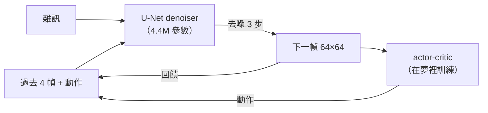
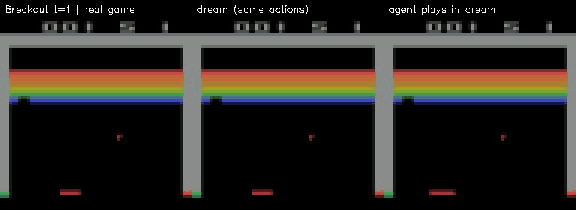
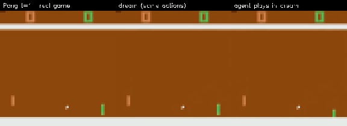
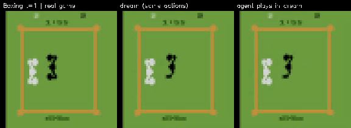
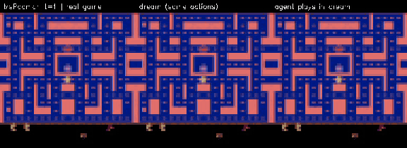
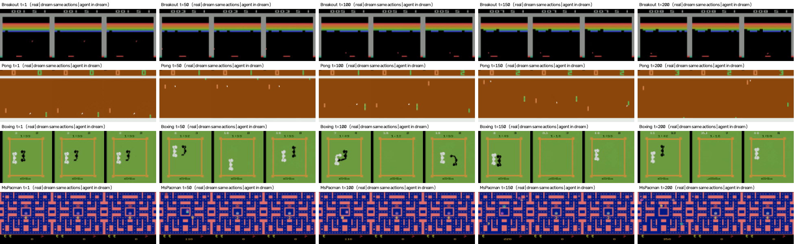
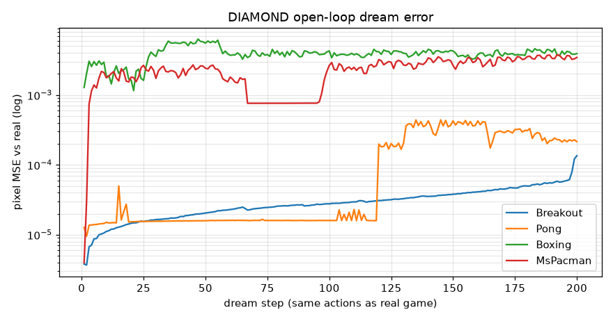

# 實驗 E：跑現成的世界模型 DIAMOND（Atari）

前面 C、D 是自己從頭訓練的小世界模型。這裡改跑別人訓練好的：
[DIAMOND](https://github.com/eloialonso/diamond)（*Diffusion As a Model Of eNvironment Dreams*，NeurIPS 2024 Spotlight）。

- **世界模型是一個 diffusion 模型**：給過去 4 幀（64×64）和動作，從雜訊去噪 3 步生成下一幀。
  不同於實驗 C、D 的「VAE 壓成 $z$ 再預測」，它直接在像素空間生成，所以細節（球、分數、磚塊）保留得很好。
- **agent 完全在夢裡訓練**：只用 Atari 100k（真實遊戲約 2 小時）的資料學世界模型，actor-critic 在夢裡練習。
- 官方在 Hugging Face 提供 26 款 Atari 遊戲的預訓練權重，每款的 denoiser 約 **4.4M 參數**。



## 安裝

DIAMOND 固定使用 Python 3.10 與 torch 2.4.1，因此放在獨立的環境，不和專案的 `.venv` 混用。
`external/` 不進 git。

```bash
mkdir -p external && git clone --depth 1 https://github.com/eloialonso/diamond.git external/diamond
```

```bash
cd external/diamond && uv venv --python 3.10 .venv && VIRTUAL_ENV=$PWD/.venv uv pip install -r requirements.txt
```

`ale-py` 0.9 會一併安裝 Atari ROM。DIAMOND 的 README 註明：安裝即表示你確認自己有使用這些 ROM 的授權。

## 執行

### 自動錄影（本實驗）

```bash
external/diamond/.venv/bin/python exp_e/diamond_dream.py --games Breakout Pong Boxing MsPacman
```

第一次會從 Hugging Face 下載權重（每款遊戲約 20 MB）。每款遊戲做三件事，輸出並排影片：

| 欄 | 內容 |
|---|---|
| real game | 預訓練 agent 在真實遊戲裡玩（先玩 60 步暖身，再錄 200 步） |
| dream (same actions) | 只給前 4 幀真實畫面，之後餵**真實的動作序列**，讓世界模型自己生成：開環預測 |
| agent plays in dream | 同一起點，但 agent 看著**夢裡的畫面**自己決定動作：真正的「在夢裡玩」 |

### 自己用鍵盤玩（互動視窗）

```bash
cd external/diamond && .venv/bin/python src/play.py --pretrained
```

選遊戲後會開 pygame 視窗。按 `m` 切換成人類操作，`↑/↓` 調整想像長度。

## 時間（iMac M3 8GB）

| | CPU | mps |
|---|---|---|
| 做夢速度（Breakout） | **8–11 幀/秒** | 8.6 幀/秒 |

模型很小，GPU 的優勢被資料搬移成本抵消，所以 CPU 反而略快。
Atari 實際遊戲速度是 15 幀/秒（60 Hz、frameskip 4），所以 M3 上大約是 0.6 倍即時速度，勉強可玩。
4 款遊戲 × 200 步，總共約 12 分鐘。

## 結果

### 影片

每段影片從左到右：真實遊戲 | 夢（相同動作）| agent 在夢裡玩。

**Breakout**：200 步內夢和真實幾乎一模一樣，連打掉哪些磚塊、分數都對得上。



**Pong**：前 120 步一致；之後真實遊戲得分，夢裡沒得分，比分開始不同。



**Boxing**：開環的夢裡，**黑色對手在約 50 步後消失了**；agent 自己在夢裡玩時，兩個拳擊手都在。



**MsPacman**：迷宮完全穩定；小精靈與鬼的位置、分數逐漸偏離。



H.264 完整畫質：[Breakout](media/exp_e_Breakout.mp4)、[Pong](media/exp_e_Pong.mp4)、[Boxing](media/exp_e_Boxing.mp4)、[MsPacman](media/exp_e_MsPacman.mp4)

### 截圖



### 開環誤差



| 遊戲 | 第 1 步 | 第 50 步 | 第 100 步 | 第 200 步 | 參考：凍結第一幀（第 200 步） |
|---|---|---|---|---|---|
| Breakout | 0.000004 | 0.00002 | 0.00003 | **0.00014** | 0.0027 |
| Pong | 0.000013 | 0.00002 | 0.00002 | **0.00022** | 0.0007 |
| Boxing | 0.0013 | 0.0055 | 0.0043 | 0.0039 | 0.0035 |
| MsPacman | 0.000004 | 0.0024 | 0.0026 | 0.0035 | 0.0033 |

像素 MSE 會被大片靜止背景稀釋，數值要和「凍結第一幀」相比才有意義。

## 觀察

1. **Diffusion 世界模型的畫質遠勝 VAE 版**。實驗 C、D 的 VAE 把細節抹平；DIAMOND 直接在像素空間生成，
   一顆幾個像素大的球、分數數字都清楚。這也是 DIAMOND 論文的主張：*visual details matter*，
   因為 agent 要看清楚球才玩得好。
2. **「確定性」的遊戲可以夢很久**。Breakout、Pong 的物理是確定的（球的反彈只由位置、速度決定），
   只要動作序列相同，夢就能貼著真實走 100 步以上。誤差是「突然跳一下」，例如 Pong 第 120 步得分與否不同，而不是慢慢變模糊。
3. **有「看不見的意圖」的遊戲很快就分岔**。Boxing 的對手、MsPacman 的鬼由遊戲 AI 控制，
   世界模型只能猜它們下一步要幹嘛。於是約 50 步後就與真實分道揚鑣，像素誤差和「凍結第一幀」差不多。
4. **物體消失，和實驗 D 是同一個問題**。Boxing 開環夢裡黑色對手不見了：只看 4 幀的模型沒有「場上一定有兩個人」的長期記憶。
   有趣的是，agent 自己在夢裡玩時對手沒有消失。可能的原因是：餵入真實動作序列時，夢中的畫面和動作不再相符（真實 agent 是對著真實畫面出拳），
   模型進入沒見過的狀態；而 agent 在夢裡的動作與夢中畫面一致，仍在訓練分布內。
5. **8GB M3 跑得動**。4.4M 參數、CPU 每秒 8–11 幀，接近即時，可以直接當教學展示。

## 和前面實驗的對照

| | C/D（自己訓練） | E（DIAMOND 預訓練） |
|---|---|---|
| 狀態 | VAE $z$（32 維） | 過去 4 幀像素 |
| 動態模型 | MDN-LSTM / Transformer | Diffusion U-Net，去噪 3 步 |
| 畫質 | 模糊，細節消失 | 清晰，像素級 |
| 記憶 | LSTM 狀態 / 64 幀 context | 只有 4 幀 |
| 長期一致性 | 塌縮成平均畫面 | 確定性部分很好；隨機部分會分岔或物體消失 |

兩邊都沒有真正的長期記憶。DIAMOND 用「高畫質 + 短記憶」換到了 agent 夠用的模擬器，
但只要需要記住畫面外的東西（Boxing 的對手、迷宮的另一邊），就會出錯。

## 可以接著做

- **CS:GO 世界模型**（DIAMOND 的 `csgo` 分支，約 381M 參數）：第一人稱 3D，可以拿實驗 D 的「原地轉圈」考它。在 8GB M3 上是否跑得動待測。
- **調整去噪步數**：`config/trainer.yaml` 的 `num_steps_denoising`，在速度與畫質之間取捨。
- **量化「物體消失」**：用簡單的顏色偵測計算 Boxing 夢中對手存在的比例，比較開環與 agent-in-dream。
