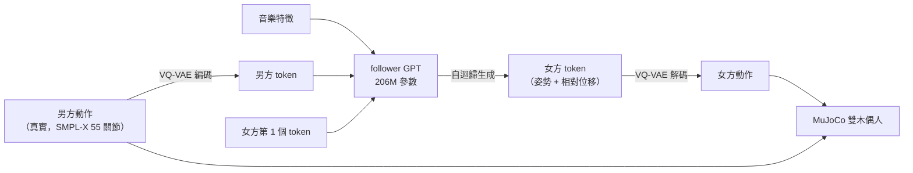

# 實驗 F：雙人舞的「跟舞」模型 Duolando（DD100 Jive）

前面的世界模型預測的是「畫面」或「物體位置」。這裡換成**人體動作**：
給真實的男方（leader）動作和音樂，讓模型生成女方（follower）怎麼跳，再放進 MuJoCo 讓兩個木偶人一起跳。
女方的模型本質上就是一個互動世界模型：$\text{女方}_{t+1} = f(\text{女方}_{\le t},\ \text{男方}_{\le t+k},\ \text{音樂})$。

- 模型：[Duolando](https://github.com/lisiyao21/Duolando)（Li et al.，ICLR 2024），南洋理工大學 S-Lab，授權為 NTU S-Lab License（僅限非商業用途）。
- 資料：論文自建的 **DD100** 雙人舞資料集，10 個舞種，含 **Jive（吉魯巴）**。
- 只用公開的預訓練權重與測試集，**不訓練、不微調**。



## 模型

Duolando 分三個部分，都是公開權重：

| 部分 | 作用 | 參數 | 權重大小 |
|---|---|---|---|
| 動作 VQ-VAE | 把上半身、下半身、雙手的姿勢壓成離散 token | 116.5M | 470 MB |
| 位移 VQ-VAE | 把「女方相對男方的位置」壓成 token | 17.3M | 70 MB |
| follower GPT | 看音樂、男方 token、自己過去的 token，預測女方下一個 token | 206M | 825 MB |
| follower GPT + RL | 同上，再用離線強化學習微調，獎勵懲罰腳滑與互相穿過 | 206M | 825 MB |

生成時只給女方**第一個 token**（約 8 幀）當起點，之後整段都由模型自己往下滾。男方動作則完整給定，所以模型看得到男方接下來要做什麼。

## 安裝

Duolando 用 Python 3.10，放在獨立環境；`external/` 不進 git。

```bash
git clone https://github.com/lisiyao21/Duolando.git external/duolando
```

```bash
cd external/duolando && uv venv --python 3.10 .venv && VIRTUAL_ENV=$PWD/.venv uv pip install torch==2.4.1 "numpy<2" scipy easydict pyyaml tqdm matplotlib opencv-python smplx
```

從 Duolando README 的 Google Drive 連結下載兩個檔案，解壓在 `external/duolando/` 下：

| 檔案 | 內容 | 大小 | 下載時間（約 0.5 MB/s） |
|---|---|---|---|
| `data__lazy.zip` | DD100 前處理後的動作與音樂特徵 → `data/` | 5.1 GB（解開 6.4 GB） | 2 小時 17 分 |
| `experiments.zip` | 四個權重 → `experiments/` | 2.0 GB | 46 分 |

```bash
cd external/duolando && uvx gdown 1MpoytmnSGbiVLSOL0QKvGz4dmW_8TrH6 && uvx gdown 1DT9fzaz7M2ls7dqS1jwJdQc3Cy78_9Oy
```

```bash
cd external/duolando && unzip -q data__lazy.zip && unzip -q experiments.zip
```

### 讓它在 Mac 上跑

原始程式只支援 CUDA。[`exp_f/duolando_follow.py`](../exp_f/duolando_follow.py) 不改 Duolando 的程式碼，而是：

- 把 `torch.Tensor.cuda`、`nn.Module.cuda` 換成「搬到 CPU」，因為模型裡有很多寫死的 `.cuda()`。
- `pytorch3d` 在 Mac 上難裝，而 Duolando 只 import 它、沒有真的用到，所以放一個替身 [`exp_f/_shims/pytorch3d`](../exp_f/_shims/pytorch3d)。
- 推論流程照抄 Duolando 的 `eval()`，只挑指定舞種。

## 執行

```bash
external/duolando/.venv/bin/python exp_f/duolando_follow.py --genre Jive
```

```bash
external/duolando/.venv/bin/python exp_f/duolando_follow.py --genre Jive --config configs/rl_final_debug_reward3_random_5mem_lr3e-5.yaml --out out/exp_f_rl
```

```bash
uv run python exp_f/render_duet.py --rl out/exp_f_rl
```

前兩行分別用 GPT 版與 RL 版生成女方，輸出 `out/exp_f*/<片段>.npz`（男方、真實女方、生成女方各 $(T, 55, 3)$ 關節位置）。
第三行用 [`exp_f/puppet.py`](../exp_f/puppet.py) 在 MuJoCo 畫膠囊木偶人、錄影，並計算指標寫進 `out/exp_f/metrics.json`。
木偶人只做運動學播放：每一幀把關節位置畫進場景，不跑物理模擬。

## 時間（iMac M3 8GB，CPU）

DD100 測試集共 34 段，其中 Jive 4 段，每段 48–64 秒。

| 步驟 | 時間 |
|---|---|
| 生成一段（GPT 或 RL） | 84–176 秒，約為舞蹈長度的 2 倍 |
| 4 段 × 2 版本 | 約 15 分鐘 |

## 結果

### 影片

左：真實的一對（藍男、紅女）；中：Duolando GPT 生成的女方（橘）；右：GPT + RL（綠）。
三欄的藍色男方完全相同，都是真實動作捕捉資料。


完整 30 秒（H.264）：[media/exp_f_Jive_010_001.mp4](media/exp_f_Jive_010_001.mp4)

第 20 秒的畫面：


真實女方站在男方側邊、手搭著男方；GPT 版的女方幾乎疊在男方前面；RL 版拉開到旁邊，比較像真的雙人舞站位。

### 指標

4 段 Jive 的平均。「手相觸」以兩人最近一對手腕距離小於 15 cm 計；「穿過」以兩人軀幹關節（骨盆到頭）最近距離小於 15 cm 計；
「腳滑」是腳貼地（離最低點 5 cm 內）時的水平速度。

| 指標 | 真實女方 | GPT | GPT + RL |
|---|---|---|---|
| 兩人骨盆水平距離 | 1.10 m | 0.99 m | 1.19 m |
| 距離的標準差 | 0.29 m | 0.38 m | 0.45 m |
| 手相觸的幀數比例 | 8.2% | 2.9% | 1.9% |
| 最近手腕距離（中位數） | 0.47 m | 0.54 m | 0.67 m |
| 軀幹互相穿過的幀數比例 | 0% | 1.0% | 0.5% |
| 身體關節平均速度 | 0.88 m/s | 1.20 m/s | 1.01 m/s |
| 腳滑速度（中位數） | **0.09 m/s** | 1.20 m/s | 0.93 m/s |
| 與真實女方的姿勢差（相對骨盆） | — | 0.18 m | 0.18 m |

以 Jive_010_001 進一步看骨盆和腳：

| | 真實 | GPT | GPT + RL |
|---|---|---|---|
| 骨盆水平速度 | 0.49 m/s | 0.83 m/s | 0.77 m/s |
| 腳離地高度（中位數） | 4 cm | 18 cm | 18 cm |

## 觀察

1. **看得出是在跳 Jive**。從影片看，生成的女方會踏步、轉身、擺手，動作風格像 Jive；是否踩在拍點上，這裡沒有量。和真實女方的姿勢差約 18 cm，但這不代表錯：同一段男方可以有很多種合理的女方跳法。
2. **最弱的是「雙人互動」**。真實舞者有 8% 的時間手接觸，生成的只有 2–3%。這個模型以 token 為單位預測姿勢與相對位移，沒有「手要握住對方」的硬性約束，接觸只能靠統計湊出來。
3. **腳沒有踩住地面**。生成女方的腳中位數離地 18 cm，而且骨盆移動得比真人快。姿勢 token 和位移 token 是分開解碼再相加的，沒有東西強迫「著地的腳不能動」，所以看起來像在滑冰。
4. **RL 微調確實有改善，但有限**。穿過的比例減半（1.0% → 0.5%），腳滑降約 2 成，第 20 秒的畫面裡站位拉開到側邊，比較像真的雙人舞。但它是用拉開距離換來的：手接觸反而更少。這正是實驗 E 和 [世界模型與強化學習](rl_vs_world_model.md) 提到的「策略鑽獎勵漏洞」：獎勵懲罰穿模，最省事的解就是離遠一點。
5. **對照前面的實驗**：
   - 和 C、D 一樣，它是在離散或壓縮空間裡自迴歸往前滾。不同的是，它每一步都看得到真實的男方動作和音樂，所以不會塌縮成「平均動作」。這對應到 E 的 Breakout：有外部輸入一直拉著，夢才不會走偏。
   - 它不懂物理。重力、地面、接觸都只是統計，和 C、D 的 VAE 世界模型一樣。

## 授權

Duolando 的程式碼與權重採 NTU S-Lab License 1.0，只能用於非商業用途；DD100 資料也以研究用途公開。本實驗只做教學與研究上的推論與視覺化。

## 可以接著做

- **其他舞種**：`--genre` 換成 Waltz、Tango、Samba 等。DD100 共 10 種，不必重新下載。
- **把男方換成生成的**：先用單人的音樂生舞模型（例如 EDGE）生成男方，再讓 Duolando 跟，就是完全「夢出來」的雙人舞。
- **加上物理**：把關節位置重定向（retarget）到 MuJoCo 的人形或 Unitree G1 機器人，用追蹤控制器跟著跳。這樣腳滑、穿模會直接變成跌倒，是比這裡的指標更嚴格的檢查。
- **用 SMPL-X 網格取代火柴人**：`data/motion/smplx` 已經有參數，可以畫出有體積的人，比較容易看出穿模。
