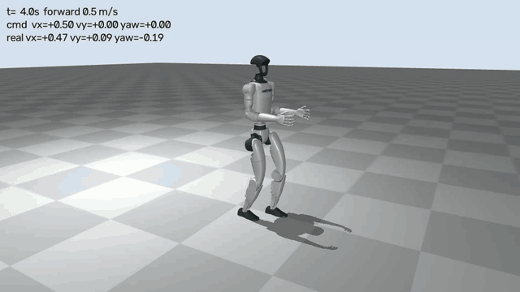
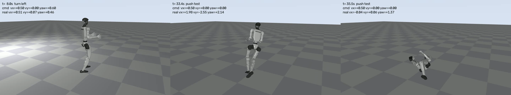

# 實驗 G：G1 在物理模擬中走路（Unitree 官方預訓練策略）

[實驗 F](exp_f.md) 的 G1 只是「照關節角度播放」：每一幀直接設定姿勢，不受重力，也不會跌倒。
這裡換成真的物理：G1 只能靠腿上 12 顆馬達出力，站穩、走路、被推時要自己救回來。
控制器是 Unitree 官方 [unitree_rl_gym](https://github.com/unitreerobotics/unitree_rl_gym)（BSD-3）附的預訓練行走策略，**不需要訓練**。


## 這個策略是什麼

- **怎麼訓練的**：用 PPO 在 NVIDIA Isaac Gym 裡，同時跑幾千台 G1 練出來的（legged_gym 框架）。獎勵是「跟上速度指令」，加上姿勢、力矩、腳步等規範項。
- **輸入**：47 個數字。包括身體角速度、重力在身體座標的方向、速度指令 $(v_x, v_y, \omega_z)$、12 個關節的角度與角速度、上一步的輸出，以及步態相位 $(\sin, \cos)$，週期 0.8 秒。
- **輸出**：12 個數字，是兩腿各 6 個關節的目標角度。再由 PD 控制器換成力矩

$$
\tau = k_p (q^* - q) - k_d \dot q ,\qquad q^* = 0.25\,a + q_0 .
$$

- **限制**：只控制腿，用的是 12 個關節的 G1 模型（`g1_12dof.xml`），手臂和腰固定。這和實驗 F 用的 29 個關節版本不同。
- 它是**無模型 RL**：策略直接從感測對應到動作，沒有世界模型。見 [世界模型與強化學習](rl_vs_world_model.md)。

## 安裝

只取需要的部分，約 81 MB，`external/` 不進 git：

```bash
cd external && git clone --depth 1 --filter=blob:none --sparse https://github.com/unitreerobotics/unitree_rl_gym.git && cd unitree_rl_gym && git sparse-checkout set deploy/deploy_mujoco deploy/pre_train/g1 resources/robots/g1_description
```

不必安裝 Isaac Gym 或 legged_gym：部署只需要 `mujoco` 和 `torch`，專案的環境已經有了。

## 執行

```bash
uv run python exp_g/g1_walk.py
```

[`exp_g/g1_walk.py`](../exp_g/g1_walk.py) 的控制迴圈照抄官方的 `deploy/deploy_mujoco/deploy_mujoco.py`。差別有三點：

- 不開視窗，改成離屏錄影。
- 速度指令依時間表變化。
- 可以在骨盆上施加側向推力。

37 秒的錄影加上推擠測試，總共約 2 分 20 秒。

## 結果



完整 37 秒（H.264）：[media/exp_g_g1_walk.mp4](media/exp_g_g1_walk.mp4)

左：第 8 秒，邊走邊左轉；中：第 33.4 秒，被 300 N 側推後失去平衡；右：第 35.5 秒，倒地。



### 跟上速度指令

每段扣掉前 2 秒的加速過程，取骨盆在自身朝向座標下的平均速度：

| 時段 | 指令 $(v_x, v_y, \omega_z)$ | 實際 | 說明 |
|---|---|---|---|
| 0–6 s | (0.5, 0, 0) | (0.48, 0.00, −0.01) | 直走，誤差 5% |
| 6–11 s | (0.5, 0, 0.6) | (0.47, −0.04, 0.52) | 邊走邊左轉，轉速少 13% |
| 11–15 s | (0, 0.3, 0) | (0.04, 0.20, −0.01) | 側移，只達到 2/3 |
| 15–19 s | (0, 0, 0) | (0.02, −0.03, −0.01) | 原地踏步（策略一直在踏步，不會靜止站著） |
| 19–25 s | (0.8, 0, 0) | (0.76, 0.02, −0.02) | 加速，誤差 6% |

前 33 秒一共走了約 8.7 m，沒有跌倒。

### 推擠測試

以 0.5 m/s 直走到第 4 秒時，在骨盆上施加 0.2 秒的側向推力，再觀察 4 秒：

| 推力 (N) | 100 | 150 | 160 | 170 | 180 | 190 | 200 | 300 |
|---|---|---|---|---|---|---|---|---|
| 倒了嗎 | 否 | 否 | **是** | 是 | 是 | 是 | 是 | 是 |

150 N 推 0.2 秒，等於給 32 kg 的機器人（模型的總質量）約 0.9 m/s 的側向速度，它能踏步救回來；160 N 以上就倒。
這個門檻只測了一個時間點，實際還和被推時在步態週期的哪個階段有關。
影片裡第 27、30 秒各被推 150 N，都撐住了；第 33 秒推 300 N，倒地。

## 觀察

1. **物理下的「會走路」和實驗 F 的「播放動作」是兩回事**。實驗 F 的 G1 能擺出任何姿勢，因為不用管平衡；這裡每一步都要靠腳底的接觸力撐住身體，被推了要立刻調整落腳點。
2. **小策略就夠了**。142 KB 的 MLP 就能讓 32 kg 的機器人穩定行走、轉彎、抗推。難的是訓練：要在 GPU 上跑數千個平行環境、數億步。部署只需要 CPU。
3. **它只會一種步態**。即使指令是「站著」，它也在原地踏步。因為訓練時有固定 0.8 秒週期的步態相位輸入和腳步獎勵，策略學到的是「一直踏步的走路」，不是「站立」加「走路」。
4. **能走路 ≠ 能跳舞**。它只接受 3 個速度指令，沒辦法叫它做實驗 F 的舞步。要讓 G1 在物理中跳 Duolando 生成的舞，需要「動作追蹤策略」，輸入是目標姿勢而不是速度。這類現成模型（PHC、ProtoMotions、BeyondMimic 等）多半要 NVIDIA Isaac，在 Mac 上要自己訓練，需要數天。

## 可以接著做

- **把實驗 F 的舞步當成速度指令**：從生成的女方骨盆軌跡算出 $(v_x, v_y, \omega_z)$ 餵給這個策略。G1 會用走路的方式跟著跑位，可以看出舞步的移動能不能用物理實現，但不會有舞蹈的姿勢。
- **地形與擾動**：加斜坡、台階、更低的摩擦係數，或在步態不同階段推它，畫出「推力 × 相位」的倒地地圖。
- **自己從零訓練**：用 SAC 或 PPO 在這台 M3 上訓練 Gymnasium 的 `Walker2d`（約 1 小時）或 `Humanoid`（約一晚），和這個官方策略比較步態。
