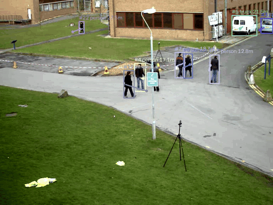
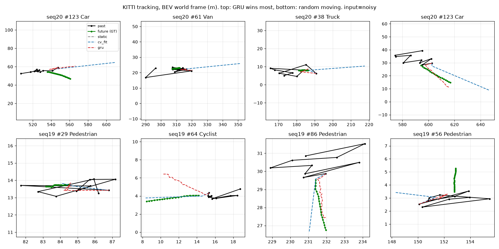
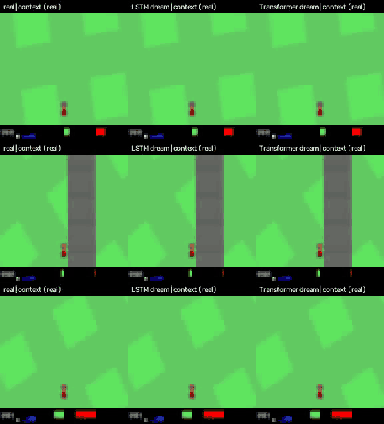
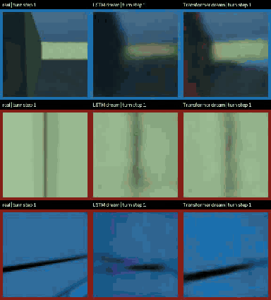

# 世界模型實驗總覽

這份文件把背景知識和四個實驗串起來。各實驗的細節、指令與完整數據見各自的文件：
[A](exp_a.md)、[B1](exp_b.md)、[C](exp_c.md)、[D](exp_d.md)。所有實驗都在 iMac M3（8 GB）上完成。

## 1. 背景

### 1.1 世界模型是什麼

世界模型就是一個轉移函數：給現在的狀態和動作，預測下一刻的世界。

$$
s_{t+1} = f(s_t, a_t)
$$

各種世界模型的差別在於**狀態 $s$ 怎麼表示**、**在哪個空間預測**：

| 路線 | 代表 | 狀態 | 預測空間 | 特色 |
|---|---|---|---|---|
| 手寫物理狀態 | Kalman、自駕軌跡預測 | 物體 3D 位置與速度 | 明確座標 | 可解釋、省算力，只描述定義過的東西 |
| 潛在世界模型 | World Models (2018)、DreamerV3 | 學出來的小向量 | 潛在空間 | 讓 agent 在「夢裡」練習 |
| 表徵預測 | V-JEPA、V-JEPA 2 | ViT 特徵 | 特徵空間（不還原像素） | 主張預測像素是浪費 |
| 影片生成即模擬器 | Sora、Cosmos | 影片 token | 像素空間 | 畫面逼真，物理不一定對 |
| 可互動生成世界 | Genie 1/2/3 | 影片 token + 潛在動作 | 像素空間 | 可即時操控；Genie 3 主打離開再回來仍一致 |

### 1.2 單眼 3D：YOLO + Depth Anything

- YOLO 給物體類別與 2D 框，Depth Anything 給每個像素的深度。兩者合起來就能做單眼 3D 物體偵測，得到的是 **2.5D**：物體的 3D 位置、大小、朝向。
- 不訓練也能做：取框內深度中位數當 $Z$，用相機內參反投影

$$
X = \frac{(u-c_x)Z}{f_x},\qquad Y = \frac{(v-c_y)Z}{f_y}
$$

- 限制：
  - 要用 metric 版深度模型才有公尺單位。
  - 需要相機內參。
  - 物體背面看不到，大小與朝向主要靠類別去猜。
- 相關研究：Pseudo-LiDAR（2019）、Cube R-CNN / Omni3D（2023）。

### 1.3 RNN 還是 Transformer

| | RNN（LSTM/GRU） | Transformer |
|---|---|---|
| 訓練 | 依序計算，慢 | 可平行，快 |
| 推論、做夢 | 每步 $O(1)$ | 每步 $O(t)$，KV cache 會成長 |
| 長期記憶 | 弱 | 強，可直接回看任一幀 |
| 代表 | World Models、DreamerV3（RSSM） | IRIS、STORM、Genie |

小資料、短記憶的任務，兩者差不多，RNN 更省；大資料、長影片才是 Transformer 的主場。實驗 C 與 D 實際測了這件事。

## 2. 實驗路線

| 實驗 | 狀態表示 | 動態模型 | 資料 | 在 M3 上的時間 |
|---|---|---|---|---|
| A | 物體 $(X,Y,Z)$，來自 YOLO11n + Depth Anything V2 | 等速 Kalman | OpenCV `vtest.avi`，795 幀 | 感知 7 分鐘，預測不到 1 秒 |
| B1 | 世界座標鳥瞰 $(x,y)$，KITTI 真值 | GRU vs 等速外插 | KITTI Tracking 標註（約 18 MB） | 每組訓練約 20 秒 |
| C | VAE 潛在 $z \in \mathbb{R}^{32}$ | MDN-LSTM vs MDN-Transformer | CarRacing 隨機策略 12 萬幀 | 約 35 分鐘 |
| D | 同 C | 同 C | Memory Maze 10.8 萬幀 | 約 35 分鐘 |

## 3. 各實驗重點

### A：單眼 3D 追蹤 + Kalman 預測

預測 1 秒後的鳥瞰誤差（ADE，公尺）：

| 原地不動 | 兩點外插 | Kalman |
|---|---|---|
| **1.00** | 3.10 | 1.09 |

- 單眼深度噪音很大：停著的車在鳥瞰圖上沿視線方向被拉成 3–5 m 的長條。
- 兩點外插會把噪音放大 10 倍；Kalman 好很多，但仍略輸「原地不動」。
- 疑點：拿來當答案的也是有噪音的觀測，所以無法判斷瓶頸在感知還是動態。B1 接著回答這個問題。

### B1：KITTI 真值上的學習式動態模型

預測 1 秒後（ADE，公尺）：

| 輸入 | 原地不動 | 兩點外插 | 直線擬合 | GRU |
|---|---|---|---|---|
| 真值 | 1.33 | 0.18 | 0.19 | **0.15** |
| 加單眼深度噪音 | 2.41 | 15.42 | 2.10 | **1.81** |

- 用 GPS/IMU 扣掉自車運動後，車速中位數從 9.2 m/s 降到 0.19 m/s（大多是停著的車）。
- 真值輸入下，物理已經很強，GRU 只好 10–20%。
- 深度噪音讓誤差放大約 10 倍，遠大於模型之間的差距。**結論：瓶頸在感知。**

### C：World Models（CarRacing）

| | 第 10 步誤差 | 第 100 步誤差 | 做夢速度 |
|---|---|---|---|
| 複製最後一幀 | 0.0109 | 0.0140 | — |
| LSTM（423K） | 0.0039 | **0.0098** | **4,148 步/秒** |
| Transformer（864K） | **0.0032** | 0.0103 | 563 步/秒 |

- 只看 16 幀後，夢裡的賽道會隨方向盤與油門正確移動，甚至想像出彎道。
- 短期 Transformer 略好，長期打平；LSTM 做夢快 7 倍。在這個規模，RNN 是比較好的選擇。
- VAE 把草地紋理抹平，只留道路與車：重建像素會把容量花在不重要的細節上（V-JEPA 的論點）。
- CarRacing 是俯視視角，畫面本身就是 2D 地圖，考不到 3D。

### D：Memory Maze 考 3D

線性探針，從模型內部讀出各種量（$R^2$）：

| 能力 | 當下畫面 $z$ | LSTM | Transformer |
|---|---|---|---|
| 單張畫面 3D 感知：正前方牆的距離 | 0.55 | **0.74** | 0.69 |
| 短期記憶：過去 20 步轉了多少 | 0.09 | **0.27** | 0.26 |
| 地圖：絕對位置、朝向、迷宮格局 | ≈0 | ≈0 | ≈0 |

- 夢裡原地轉 4 圈：前 10 步正確想像出旁邊的牆；約 15 步後塌縮成「平均的走廊」。真實畫面每 20 步回到原樣，夢不會。
- 模型學到的是「這種迷宮轉頭大概長這樣」的統計常識，不是「這裡四周有什麼」的空間記憶。
- 即使起點畫面還在 Transformer 的 context 內，它也沒有回頭拿來用。

## 4. 總結論

1. **3D 感知可以從單張畫面得到**。Depth Anything（實驗 A）和 VAE 的 $z$（實驗 D，正前方牆距離 $R^2$ 0.55）都證明了這點。但單眼深度的誤差和距離成正比，在實驗 A、B1 中是誤差的主要來源。
2. **短期動態，物理很難打敗**。1–2 秒的車輛、行人運動幾乎是等速直線（B1）。學習式模型的優勢在於知道類別（停著的車）、會轉彎或停下的行為，以及多物體互動。
3. **學出來的世界模型擅長「常識」，不擅長「記憶」**。C、D 的模型都能想像出合理的下一幀，但長時間後就塌縮成平均畫面，轉一圈也回不到原樣（D）。
4. **明確 3D 結構保證一致性，學出來的狀態有彈性**。A/B 的座標系天生保證「轉一圈回到原地」，但只描述定義過的物體；C/D 的潛在狀態能描述整個畫面，卻會忘記世界。結合兩者，例如顯式地圖或位姿加上學出來的外觀，是目前研究的方向（SLAM + 神經場、Genie 3 的場景記憶）。
5. **在小規模上，RNN 是務實的選擇**。Transformer 在短期略好，但做夢慢 7 倍，長記憶的優勢在 64 幀內沒有顯現（C、D）。

## 5. 下一步候選

| 方向 | 內容 | 預計時間 |
|---|---|---|
| D：加入轉圈資料 | 收集時刻意加入原地轉圈、走過去再走回來 | 約 35 分鐘 |
| D：多步預測損失 | 訓練時讓 M 自己滾 k 步再算 loss，懲罰長期漂移 | 約 40 分鐘 |
| D：非線性探針 | 用小 MLP 取代線性迴歸，確認資訊是沒有還是非線性 | 幾分鐘 |
| C：控制器 | $a = W[z,h] + b$，用 CMA-ES 讓車學會開 | 一晚 |
| B：多物體互動 | 輸入加入鄰近物體，看能否學到避讓 | 約 30 分鐘 |
| B2：真實感知 | 在 KITTI 影像上跑實驗 A 的感知（需下載 15 GB） | 約 2 小時 |
