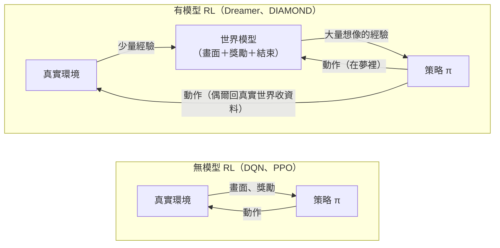
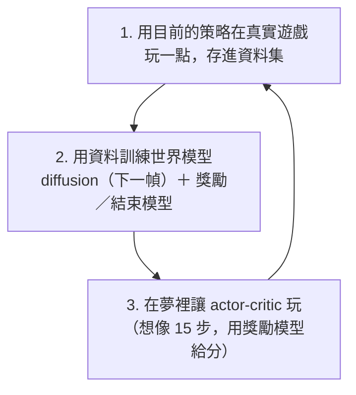

# 世界模型與強化學習

世界模型不是強化學習的替代品，兩者通常是合作關係。
準確地說，要比較的是**無模型 (model-free)** 和**有模型 (model-based)** 強化學習。
[實驗 E](exp_e.md) 的 DIAMOND 本身就是強化學習：它的 agent 用 actor-critic 學會玩遊戲，
只是練習的場地從真實遊戲換成了世界模型的夢。

## 1. 兩種強化學習

| | 無模型 RL | 有模型 RL（世界模型） |
|---|---|---|
| 學什麼 | 直接學「看到 X 就做 Y」（策略或價值函數） | 先學「做了 Y 世界會怎樣」，再用它學策略 |
| 經驗從哪來 | 全部來自真實環境 | 少量真實，大量想像 |
| 樣本效率 | 低：Atari 通常要數千萬幀（數百小時遊戲） | 高：Atari 100k 只用 40 萬幀（約 2 小時） |
| 計算量 | 每步便宜 | 要多訓練一個模型，想像也要算 |
| 主要風險 | 真實互動太貴或太危險（機器人、自駕） | **模型誤差被策略鑽漏洞**：在夢裡找到「作弊招」，在真實世界無效 |
| 能否做沒做過的事 | 不能事先試 | 可以先在腦中模擬再決定 |

用式子表示：無模型 RL 直接最佳化真實環境中的期望回報

$$
\max_\pi \; \mathbb{E}_{\text{real}}\Big[\sum_t \gamma^t r_t\Big],
$$

有模型 RL 則先從資料學一個環境模型 $\hat p(s_{t+1}, r_t \mid s_t, a_t)$，再在模型裡最佳化

$$
\max_\pi \; \mathbb{E}_{\hat p}\Big[\sum_t \gamma^t \hat r_t\Big].
$$

兩者的差距 $\mathbb{E}_{\text{real}} - \mathbb{E}_{\hat p}$ 來自模型誤差。想像的步數越長，誤差累積越多。
所以 Dreamer、DIAMOND 都只在夢裡滾十幾步（DIAMOND 預設 15 步），並且不斷回真實環境收新資料、修正模型。

## 2. DIAMOND 的訓練迴圈

- 實驗 E 影片中的「agent plays in dream」，就是第 3 步的樣子。
- 第 2 步除了下一幀，還要預測**獎勵**和**遊戲是否結束**，因為策略學習需要分數，而夢裡的分數只能由世界模型給。

## 3. 世界模型的三種用法

| 用法 | 怎麼做 | 代表 | 需要 RL 嗎 |
|---|---|---|---|
| **在夢裡訓練策略** | 想像大量經驗，用 actor-critic 或演化策略學 | World Models (2018)、Dreamer、DIAMOND | 要 |
| **決策時規劃** | 每次行動前在模型裡試多種動作序列，挑最好的 | MuZero（樹搜尋）、PlaNet、TD-MPC（MPC）、V-JEPA 2-AC（CEM） | 不一定，可以只用規劃 |
| **純粹的模擬器** | 預測未來或生成影片，不訓練 agent | Genie、Cosmos、Sora | 不用 |

### 世界模型要不要重建畫面？

兩個極端的設計：

| | MuZero | DIAMOND |
|---|---|---|
| 世界模型預測什麼 | 只預測獎勵、價值、策略所需的潛在狀態 | 完整的下一幀像素 |
| 理由 | 畫面細節大多與決策無關，不必浪費容量 | Atari 裡幾個像素的子彈就決定生死，細節很重要 |
| 類似想法 | V-JEPA：在特徵空間預測，不還原像素 | Sora、Genie：像素即世界 |

實驗 C、D 的 VAE 是兩者之間的折衷：重建像素，但壓縮成 32 維，結果細節被抹平（見 [C](exp_c.md)、[D](exp_d.md) 的 VAE 重建圖）。

## 4. 對應到我們的實驗

| 實驗 | 世界模型 | 策略學習（RL） |
|---|---|---|
| [A](exp_a.md)、[B1](exp_b.md) | 手寫或學習的動態模型 | 無：只做預測 |
| [C](exp_c.md) | VAE + MDN-RNN | **沒做**：控制器那一步（CMA-ES 演化策略）跳過了 |
| [D](exp_d.md) | 同 C | 無：只考它懂不懂 3D |
| [E](exp_e.md) | DIAMOND diffusion | **有**：預訓練的 actor-critic，就是在夢裡練出來的 |

前四個實驗只做了「世界模型」那一半。若要體驗完整的有模型 RL：

- **補上實驗 C 的控制器**：控制器 $a_t = W[z_t, h_t] + b$ 只有 867 個參數，用 CMA-ES 在夢裡或真實環境優化，8GB M3 上約一晚。
- **從頭跑一次 DIAMOND 的完整訓練**（例如 Pong）：官方設定是在 CUDA GPU 上跑，在 8GB M3 上大概要好幾天，不太實際。
